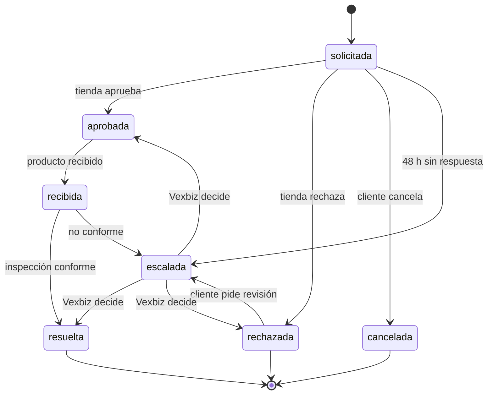

# Especificación técnica — Flujo de devoluciones Vexbiz

16 de noviembre de 2026 · Eduardo Marcano

> La versión editable de este documento está en Claude Docs. Este archivo es una copia para el repositorio.

## Resumen y alcance

El cliente inicia la devolución desde un pedido entregado, con su sesión iniciada. Sus datos y los del pedido se cargan solos, así que solo responde qué devuelve, por qué y cómo quiere resolverlo. La tienda aprueba o rechaza en 48 horas hábiles; si no responde, la solicitud se escala a Vexbiz.

El flujo está inspirado en Amazon (el cliente elige producto, motivo, solución y forma de envío desde su pedido) y en Mercado Libre (plazos según el motivo y mediación cuando hay disputa).

**Entra en el MVP:**

- Formulario del cliente en 6 pasos, dentro de Mis compras.
- Reglas de plazo, productos no retornables y responsable del traslado.
- Estados de la devolución, con un historial de cambios.
- Notificaciones por correo y WhatsApp al cliente y a la tienda.
- Bandeja de devoluciones en el panel de la tienda: aprobar, rechazar y marcar como recibida.
- Vista de administración de Vexbiz para resolver los casos escalados.

**Queda para la fase 2:**

- Reembolso automático por la API de Spidi. En el MVP operaciones hace el pago móvil a mano y lo marca como pagado.
- Retiro automático con fleteros (Vexbiz Flete). En el MVP se coordina a mano.
- Reportes de tasa de devolución por tienda, producto y motivo.

El prototipo visual del formulario es solo una referencia de los textos y la lógica. El diseño final sigue los estilos del marketplace.

## Punto de entrada y datos precargados

El cliente no escribe sus datos personales ni los del pedido: todo sale de la sesión y del pedido seleccionado.

**Dónde aparece el botón "Solicitar devolución":**

1. En Mis compras, en el detalle de un pedido con estado Entregado.
2. En cada producto de ese pedido. Si el cliente entra desde un producto, ese producto llega ya marcado en el paso 1.

**Cuándo se muestra el botón:**

- El pedido está en estado Entregado.
- Han pasado 30 días o menos desde la fecha de entrega.
- Hay al menos un producto que se puede devolver.
- El producto no tiene ya una devolución abierta. Si la tiene, el botón cambia a "Ver devolución DEV-…".

**Datos que se cargan solos:**

| Dato | Fuente | ¿El cliente lo puede editar? |
| --- | --- | --- |
| Nombre y apellido | Perfil del usuario en sesión | No |
| Correo | Perfil del usuario | No |
| Teléfono (WhatsApp) | Perfil del usuario | Sí, solo como teléfono de contacto de esta devolución. No cambia el perfil |
| Cédula | Perfil del usuario | No. Se usa para el reembolso |
| Número de pedido | Pedido seleccionado | No |
| Fecha de entrega | Fecha en que el pedido pasó a Entregado | No |
| Tienda | Pedido | No |
| Productos, cantidades y precios pagados | Líneas del pedido | No (solo elige cuáles y cuántos devuelve) |
| Método de pago y banco | Pago del pedido (Spidi) | No. Si no se tiene el banco, se pide en el paso 5 |
| Dirección de entrega | Pedido | No. Se usa si elige retiro |

Arriba del formulario se muestra una tarjeta fija de solo lectura con el pedido, la tienda, la fecha de entrega, los días que le quedan de plazo y el nombre del cliente.

Si el usuario no ha iniciado sesión, se le envía a iniciar sesión y luego vuelve al formulario.

## Pasos del formulario

Son 6 pasos con una barra de progreso, y cada paso se valida antes de continuar. Los textos entre comillas son los que ve el cliente.

### Paso 1 — Productos

"¿Qué producto(s) quieres devolver?"

- Lista las líneas del pedido con foto, nombre, SKU, precio pagado y cantidad comprada.
- Cada línea tiene una casilla y un selector de cantidad (de 1 a la cantidad comprada menos lo que ya se haya devuelto).
- Una línea no retornable se muestra deshabilitada con la etiqueta "No retornable" y su razón.
- Una línea "Solo por defecto" se puede marcar, pero se valida en el paso 2.
- **Validación:** al menos 1 producto marcado.

### Paso 2 — Motivo

"¿Por qué lo devuelves?" El cliente elige un solo motivo por solicitud. La lista completa con sus códigos está en Reglas de negocio.

Según el motivo aparecen preguntas extra, todas obligatorias:

| Motivo | Pregunta extra | Tipo y opciones |
| --- | --- | --- |
| defectuoso | "¿Qué falla presenta?" | Lista: No enciende / no funciona · Funciona de forma intermitente · Se dañó en el primer uso · Pieza rota o desprendida · Fuga, filtración o mal sellado · Otra falla |
| defectuoso | "¿Cuántas veces lo usaste antes de la falla?" | Lista: Nunca lo pude usar · 1 vez · De 2 a 5 veces · Más de 5 veces |
| danado | "¿Cómo llegó el empaque?" | Lista: Empaque intacto, producto dañado por dentro · Empaque golpeado o aplastado · Empaque abierto o roto · Sin empaque |
| equivocado | "¿Qué recibiste en su lugar?" | Texto corto |
| incompleto | "¿Qué falta?" | Texto corto |
| descripcion | "¿En qué no coincide con la publicación?" | Lista: Medida o dimensiones · Material o calidad · Color o acabado · Marca o modelo · Potencia, voltaje o capacidad · Otro dato de la ficha |
| compatibilidad | "¿La publicación indicaba la medida o compatibilidad correcta?" | Lista: No, la ficha no lo decía o estaba mal (no) · Sí, fue un error mío al elegir (si) · No estoy seguro (nose) |

Después, para todos los motivos: "Cuéntanos con más detalle", un texto libre obligatorio de 20 a 1.000 caracteres.

**Validaciones del paso 2:**

- Que el motivo esté dentro de su plazo. Si no, el mensaje es: "Para este motivo el plazo es de X días y ya pasaron Y. Si el producto tiene una falla, elige 'Está defectuoso'."
- Si alguna línea es "Solo por defecto", el motivo tiene que ser defectuoso, danado, incompleto o equivocado.

### Paso 3 — Estado del producto

"¿En qué estado está el producto?"

- **Condición** (obligatoria, elige una): Sin abrir (sellado) · Abierto, sin usar (abierto) · Usado (usado).
- **Casillas opcionales:** "Conservo el empaque original" · "Tiene todos sus accesorios, manuales y piezas" · "Tengo la factura o nota de entrega".
- Si la condición es Usado y el responsable es el cliente, se muestra este aviso: "Si lo devuelves por arrepentimiento y ya está usado o sin empaque, la tienda puede rechazar la devolución o aplicar un descuento."

### Paso 4 — Fotos

"Sube fotos del producto"

- Hasta 6 imágenes JPG, PNG o WEBP de máximo 8 MB cada una. Se comprimen en el cliente antes de subirlas.
- Son obligatorias (mínimo 2) con los motivos defectuoso, danado, incompleto, equivocado y descripcion. Con danado, el texto pide incluir una foto del empaque.
- Con los demás motivos son opcionales.
- Las fotos se guardan en almacenamiento privado y solo las ven el cliente, la tienda y el administrador.

### Paso 5 — Solución y entrega

"¿Cómo quieres resolverlo?" (obligatorio, elige una):

- Cambio por el mismo producto (cambio). Solo se ofrece si la tienda tiene existencia; si no, la opción sale deshabilitada.
- Reembolso del dinero (reembolso): al mismo medio de pago, después de que la tienda revisa el producto.
- Saldo a favor en Vexbiz (saldo): se acredita apenas la tienda recibe el producto. Esta opción depende de que exista la billetera; si no existe al lanzar, se oculta.

Si elige reembolso, se muestran el banco y la cédula que ya están registrados y se pide confirmarlos. El cliente solo los escribe si faltan.

"¿Cómo nos entregas el producto?" (obligatorio):

- Lo llevo a la tienda (tienda). Al aprobarse se le envían la dirección y el horario.
- Que lo retiren en mi dirección (retiro), a la dirección del pedido.

Debajo se muestra un aviso con quién paga el traslado, calculado con las reglas de responsable.

### Paso 6 — Confirmar

- Muestra un resumen: pedido, productos y cantidades, monto, motivo, condición, número de fotos, solución, forma de entrega y quién paga el traslado.
- Casilla obligatoria: "Acepto la política de devoluciones de Vexbiz", con un enlace a la política.
- Botón "Enviar solicitud". Al enviarla se crea la devolución, se muestra el número DEV-AAAA-NNNNN y se lleva al cliente a la página de seguimiento.

Las validaciones de plazos, productos no retornables y cantidades se repiten en el backend. El frontend no es la única barrera.

## Reglas de negocio

Los plazos dependen del motivo: 7 días si el cliente cambió de opinión y 30 días si el problema no es suyo. Quién causó el problema decide quién paga el traslado. Plazos, horas de respuesta y máximo de fotos van en configuración, no fijos en el código.

### Catálogo de motivos

| Código | Texto para el cliente | Grupo | Responsable | Plazo | Fotos obligatorias |
| --- | --- | --- | --- | --- | --- |
| defectuoso | Está defectuoso o no funciona | Problema con el producto | tienda | 30 días | Sí |
| danado | Llegó dañado, roto o golpeado | Problema con el producto | logistica | 30 días | Sí |
| incompleto | Faltan piezas, accesorios o unidades | Problema con el producto | tienda | 30 días | Sí |
| equivocado | Me enviaron otro producto | No es lo que pedí | tienda | 30 días | Sí |
| descripcion | No coincide con la publicación | No es lo que pedí | tienda | 30 días | Sí |
| compatibilidad | No sirve para lo que lo necesito | No es lo que pedí | depende | 7 días | No |
| error_compra | Me equivoqué al comprar | Cambié de opinión | cliente | 7 días | No |
| arrepentimiento | Ya no lo necesito | Cambié de opinión | cliente | 7 días | No |
| tarde | Llegó demasiado tarde | Cambié de opinión | logistica | 7 días | No |
| otro | Otro motivo | Otro | por_definir | 30 días | No |

Cómo se resuelve el responsable "depende" (motivo compatibilidad): si la respuesta es "no", responde la tienda; si es "si" o "nose", responde el cliente. En los casos "nose" y por_definir, la tienda o el administrador pueden cambiar el responsable al revisar.

El plazo se cuenta en días calendario desde la fecha de entrega, en hora de Venezuela (UTC-4).

### Productos no retornables

Cada producto del catálogo necesita un campo nuevo, `politica_devolucion`, con 3 valores:

- `retornable` (por defecto).
- `solo_defecto`: material cortado o fraccionado a la medida del cliente, por ejemplo cable por metro o tubería cortada. Solo se acepta con los motivos defectuoso, danado, incompleto o equivocado.
- `no_retornable`: preparado a pedido, por ejemplo pintura entonada, o químicos abiertos. No se puede seleccionar.

También hace falta un campo `motivo_no_retornable`, un texto corto que ve el cliente. La tienda define la política de cada producto al cargarlo; si no lo hace, queda `retornable`.

### Quién paga el traslado

| Responsable | Paga el traslado | Aviso al cliente |
| --- | --- | --- |
| cliente | Cliente | "Como la devolución es por decisión tuya, el traslado corre por tu cuenta". Si eligió retiro, el costo se descuenta del reembolso |
| tienda | Tienda | "El traslado no tiene costo para ti" |
| logistica | Vexbiz | "El traslado no tiene costo para ti" |
| por_definir | Se decide al revisar | "Lo definiremos al revisar tu caso" |

### Montos

- El reembolso es el precio pagado por las unidades devueltas, más el envío original si el responsable no es el cliente.
- Si la tienda recibe el producto usado o incompleto cuando el responsable es el cliente, puede proponer un reembolso parcial. Tiene que indicar el monto y un motivo, y el cliente lo acepta o lo escala.
- Comisión de Vexbiz (5%) cuando hay reembolso: **pendiente de decisión de dirección**. Puede devolverse al cliente a cargo de Vexbiz o retenerse a la tienda.

## Estados, transiciones y notificaciones

Una devolución va de Solicitada a Resuelta. Puede escalarse a Vexbiz si la tienda no responde, si la rechaza o si la inspección sale no conforme.



Estados finales: resuelta (reembolso, cambio o saldo), rechazada sin revisión y cancelada.

### Transiciones

| De | A | Quién | Condición |
| --- | --- | --- | --- |
| — | solicitada | Cliente | Pasa todas las validaciones |
| solicitada | cancelada | Cliente | Antes de que la tienda la apruebe |
| solicitada | aprobada | Tienda | Si la entrega es en tienda, indica dirección y horario |
| solicitada | rechazada | Tienda | El motivo de rechazo es obligatorio |
| solicitada | escalada | Sistema | Vence `vence_respuesta_tienda` sin respuesta |
| rechazada | escalada | Cliente | Lo pide en los 5 días siguientes al rechazo |
| aprobada | recibida | Tienda | Tiene el producto en la mano. Si el retiro no se hizo en 7 días, se avisa al admin |
| recibida | resuelta | Tienda o admin | Inspección conforme y el reembolso, cambio o saldo ya está hecho |
| recibida | escalada | Cliente | Inspección no conforme y el cliente no acepta el monto parcial |
| escalada | aprobada, resuelta o rechazada | Admin | Decisión final, con una nota obligatoria |

Para saber si la devolución está en reembolso o cambio no hace falta un estado aparte: se ve en `solucion` y en el historial de eventos. Cuando la solución es un reembolso, la devolución solo pasa a resuelta después de que operaciones carga la referencia del pago móvil.

### Notificaciones

Todas se envían por correo y WhatsApp. Si WhatsApp no está integrado al lanzar, se envían solo por correo y por notificación interna.

| Evento | Cliente | Tienda | Admin |
| --- | --- | --- | --- |
| Solicitud creada | Confirmación con el código DEV | Nueva solicitud y su plazo de respuesta | — |
| Faltan 12 h para el vencimiento | — | Recordatorio | — |
| Aprobada | Instrucciones de entrega | — | Si hay retiro: coordinar fletero |
| Rechazada | Motivo y botón "Pedir revisión" | — | — |
| Escalada | Vexbiz revisa su caso | Aviso | Caso nuevo en la bandeja |
| Recibida / inspección | Resultado de la inspección | — | Si hay reembolso: hacer el pago |
| Resuelta | Comprobante: referencia, cambio o saldo | Cierre | — |

## Modelo de datos

Se necesitan 4 tablas nuevas y 2 campos en productos. Los nombres son una propuesta y se pueden adaptar al esquema actual del marketplace.

### devoluciones

| Campo | Tipo | Nota |
| --- | --- | --- |
| id | uuid | |
| codigo | varchar, único | DEV-AAAA-NNNNN, con un consecutivo por año |
| pedido_id | FK pedidos | |
| cliente_id | FK usuarios | Sale de la sesión |
| tienda_id | FK tiendas | Sale del pedido |
| estado | enum | Ver Estados |
| motivo_codigo | enum | Catálogo de motivos |
| motivo_extra | jsonb | Respuestas a las preguntas extra del motivo |
| detalle | text | |
| responsable | enum: cliente, tienda, logistica, por_definir | Se calcula al crear la devolución; tienda o admin pueden cambiarlo |
| condicion | enum: sellado, abierto, usado | |
| empaque_original, accesorios_completos, tiene_factura | boolean | |
| solucion | enum: cambio, reembolso, saldo | |
| entrega | enum: tienda, retiro | |
| telefono_contacto | varchar | Viene del perfil, pero se puede editar en la devolución |
| monto_solicitado | decimal(12,2) USD | Calculado en el backend |
| monto_aprobado | decimal(12,2) USD, opcional | Si hay reembolso parcial |
| reembolso_banco, reembolso_cedula | varchar | Se copian del perfil o del pago |
| reembolso_referencia | varchar | Referencia del pago móvil que carga operaciones |
| motivo_rechazo | text | |
| fecha_entrega_pedido | date | Copia de la fecha, para auditar el plazo |
| vence_respuesta_tienda | timestamptz | Momento de creación más 48 horas hábiles |
| created_at, updated_at, closed_at | timestamptz | |

### devolucion_items

Campos: id, devolucion_id, pedido_item_id, producto_id, sku, nombre (copia), cantidad, precio_unitario (copia del precio pagado).

### devolucion_evidencias

Campos: id, devolucion_id, url_privada, mime, bytes, subido_por (cliente, tienda o admin), created_at. La tienda también sube fotos cuando recibe e inspecciona el producto.

### devolucion_eventos (historial)

Campos: id, devolucion_id, estado_anterior, estado_nuevo, actor_tipo (cliente, tienda, admin o sistema), actor_id, nota, created_at. Cada cambio de estado escribe una fila, y la página de seguimiento se arma con estos eventos.

### Productos

Se agregan `politica_devolucion` (enum: retornable, solo_defecto, no_retornable; por defecto retornable) y `motivo_no_retornable` (varchar, opcional).

### Payload de creación

El cliente solo envía lo que responde. Lo demás lo pone el backend a partir de la sesión y del pedido.

```json
POST /api/devoluciones
{
  "pedido_id": "VX-2026-004512",
  "items": [{ "pedido_item_id": "pi_8812", "cantidad": 1 }],
  "motivo_codigo": "defectuoso",
  "motivo_extra": { "falla": "No enciende / no funciona", "usos": "Nunca lo pude usar" },
  "detalle": "El taladro no enciende desde que lo saqué de la caja.",
  "condicion": "abierto",
  "empaque_original": true,
  "accesorios_completos": true,
  "tiene_factura": true,
  "evidencias": ["upl_01", "upl_02"],
  "solucion": "reembolso",
  "entrega": "tienda",
  "telefono_contacto": "0414-1234567",
  "acepta_politica": true
}
```

La respuesta trae el `codigo`, el `estado` ("solicitada"), el `responsable`, el `monto_solicitado` y el `vence_respuesta_tienda`.

## Panel de tienda, administración y endpoints

### Panel de la tienda: menú "Devoluciones"

- Una lista con filtros por estado. Primero las que esperan respuesta, con un contador de horas hasta el vencimiento.
- El detalle muestra los datos del cliente (nombre y teléfono), los productos, el motivo con sus respuestas, las fotos, la condición declarada, la solución pedida y quién paga el traslado.
- **Acciones:**
    - Aprobar: si la entrega es en tienda, indica la dirección y el horario de recepción.
    - Rechazar: el motivo es obligatorio y se elige de una lista (fuera de plazo, producto no retornable, las fotos no muestran el problema, otro) más un texto libre.
    - Marcar "Producto recibido".
    - Inspección: "Conforme" o "No conforme". "No conforme" exige fotos y un monto de reembolso parcial o una propuesta.
    - Marcar "Cambio despachado", cuando la solución es un cambio.
    - Cambiar el responsable: solo si está en "por definir" o la respuesta fue "nose", y con una nota obligatoria.

### Administración de Vexbiz

- Una bandeja para "Escalada", con todos los filtros: tienda, motivo, estado y fechas.
- Puede hacer cualquier acción de la tienda, y además:
    - Resolver a favor del cliente o de la tienda.
    - Cargar la referencia del pago móvil del reembolso y marcar "Reembolsada".
    - Acreditar el saldo a favor.
    - Coordinar el retiro y registrar al fletero en una nota.

### Página de seguimiento del cliente

- Está en Mis compras → Mis devoluciones → DEV-….
- Muestra una línea de tiempo con los eventos, las instrucciones del paso actual (dirección, horario y qué llevar) y el motivo si fue rechazada.
- Botón "Pedir revisión de Vexbiz", que escala el caso cuando la solicitud fue rechazada o no conforme. Está disponible durante 5 días.
- Botón "Cancelar solicitud", mientras no haya sido aprobada.

### Endpoints

| Método y ruta | Quién | Qué hace |
| --- | --- | --- |
| GET /api/pedidos/:id/devolucion/elegibilidad | Cliente | Devuelve qué líneas se pueden devolver, los días restantes por tipo de plazo, los datos precargados y si hay existencia para un cambio |
| POST /api/devoluciones/evidencias | Cliente, tienda | Sube una imagen y devuelve un id de carga |
| POST /api/devoluciones | Cliente | Crea la devolución y valida todo en el servidor |
| GET /api/devoluciones?rol=cliente\|tienda\|admin | Todos | Lista según el rol |
| GET /api/devoluciones/:codigo | Dueño, tienda, admin | Detalle con los eventos |
| POST /api/devoluciones/:codigo/aprobar | Tienda, admin | Aprueba la devolución |
| POST /api/devoluciones/:codigo/rechazar | Tienda, admin | Rechaza la devolución |
| POST /api/devoluciones/:codigo/recibir | Tienda, admin | Marca el producto como recibido |
| POST /api/devoluciones/:codigo/inspeccionar | Tienda, admin | Registra la inspección: conforme o no conforme, con monto y fotos |
| POST /api/devoluciones/:codigo/escalar | Cliente | Escala el caso a Vexbiz |
| POST /api/devoluciones/:codigo/cancelar | Cliente | Cancela la solicitud |
| POST /api/devoluciones/:codigo/resolver | Admin | Registra la decisión final, la referencia del reembolso o el saldo |

Cada endpoint revisa que el usuario tenga el rol correcto y que la devolución sea suya: una tienda solo ve sus devoluciones y un cliente solo las suyas.

## Criterios de aceptación, pruebas y pendientes

### Criterios de aceptación

- [ ] Un cliente con sesión iniciada crea una devolución desde un pedido entregado sin escribir su nombre, correo, cédula ni el número de pedido.
- [ ] Si entra desde un producto, ese producto llega marcado en el paso 1.
- [ ] El backend rechaza solicitudes fuera de plazo, productos no retornables y cantidades mayores a las compradas, aunque el frontend las deje pasar.
- [ ] La tienda recibe un aviso por correo y WhatsApp al crearse la solicitud, y puede aprobarla o rechazarla desde su panel.
- [ ] A las 48 horas hábiles sin respuesta, la devolución pasa sola a Escalada.
- [ ] Cada cambio de estado queda en el historial y le llega un aviso al cliente.
- [ ] Una tienda no puede ver devoluciones de otra tienda.

### Casos de prueba para QA

| # | Caso | Resultado esperado |
| --- | --- | --- |
| 1 | Arrepentimiento con 5 días desde la entrega | Se crea; el traslado lo paga el cliente |
| 2 | Arrepentimiento con 10 días desde la entrega | Se bloquea en el paso 2 con el mensaje de plazo |
| 3 | Defectuoso con 25 días desde la entrega y 2 fotos | Se crea; el traslado lo paga la tienda |
| 4 | Defectuoso con 1 sola foto | No deja pasar del paso 4 |
| 5 | Pedido entregado hace 31 días | No aparece el botón Devolver |
| 6 | Pintura entonada (no retornable) | Aparece deshabilitada en el paso 1 |
| 7 | Cable cortado (solo por defecto) con motivo arrepentimiento | Se bloquea en el paso 2 |
| 8 | Compatibilidad con respuesta "no" | El responsable es la tienda |
| 9 | Devolver 2 de 3 unidades y luego 2 más | La segunda solicitud solo permite 1 |
| 10 | La tienda no responde en 48 horas hábiles | Pasa a Escalada y se avisa al admin |
| 11 | Inspección no conforme con reembolso parcial | El cliente ve el monto y puede escalar |
| 12 | Enviar el POST con el pedido de otro cliente | Responde 403 |
| 13 | Elegir cambio sin existencia | La opción aparece deshabilitada |

### Pendientes antes de producción

- [ ] Dirección decide qué pasa con la comisión del 5% cuando hay reembolso.
- [ ] Legal revisa los plazos de 7 y 30 días y el texto de la política frente a la normativa venezolana de protección al consumidor.
- [ ] Decidir si "saldo a favor" sale en el MVP (depende de que haya billetera).
- [ ] Definir el calendario de días hábiles y feriados que se usa para calcular las 48 horas.
- [ ] Escribir la página pública de la política de devoluciones (se enlaza desde el paso 6).
- [ ] Las tiendas marcan `politica_devolucion` en los productos a la medida antes del lanzamiento.
